# FogsGear

歯車を組み、霧や地形資源を使って動力をつくり、島を探索・開発するブラウザーゲームです。探索マップ、資源加工、建築、スクロールによる自動処理、自由なギア設計をひとつのゲーム内で楽しめます。

> 画面例は同梱のガイド画像です。ゲームの進行状況や設定によって、画面内の数値・地形・所持品は異なります。

## 目次

- [ゲームの画面](#ゲームの画面)
- [ゲームの基本ループ](#ゲームの基本ループ)
- [遊び方](#遊び方)
- [資源と動力](#資源と動力)
- [ギアと処理](#ギアと処理)
- [スクロールの作成と運用](#スクロールの作成と運用)
- [建築・生産設備](#建築生産設備)
- [設定・セーブデータ](#設定セーブデータ)
- [起動とインストール](#起動とインストール)
- [プロジェクト構成](#プロジェクト構成)

## ゲームの画面

### 島を歩いて探索

マップを移動して地形や資源を見つけ、素材の採取・加工や建築を進めます。方向ボタン、ジョイスティック、キーボードに対応しています。

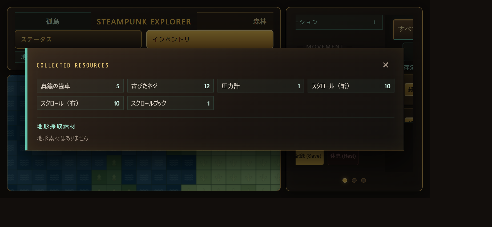

移動パッドの方向ボタンまたは中央スティックを押し続けると連続移動します。マップはドラッグで視点を移動し、マウスホイールまたはピンチで拡大・縮小できます。キーボードではW/A/S/Dまたは矢印キーを使えます。

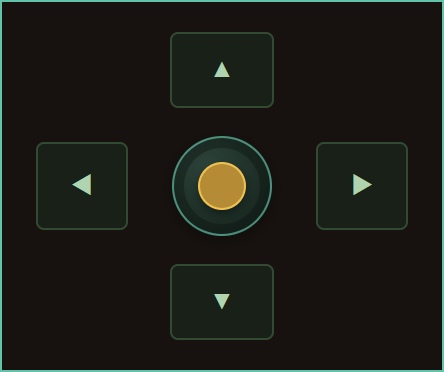

### 所持品、加工、建築

所持品は「所持品」「加工・合成」「建築」の画面で確認・管理します。レシピの材料を用意して加工品や建築キットをつくり、キットを使ってマップに設備を配置します。

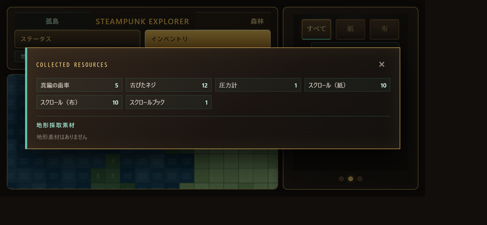

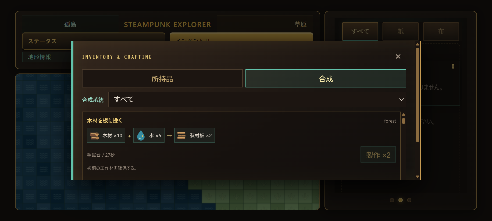

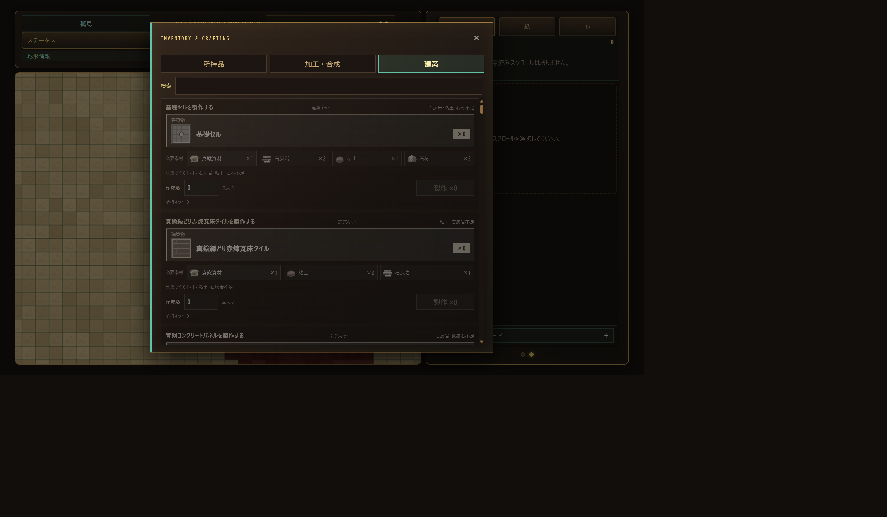

### スクロールとギア

ギアを盤面に配置して処理装置をつくり、スクロールとして保存します。保存済みの設計は書庫で選択・起動し、プレビューで動作を確認できます。

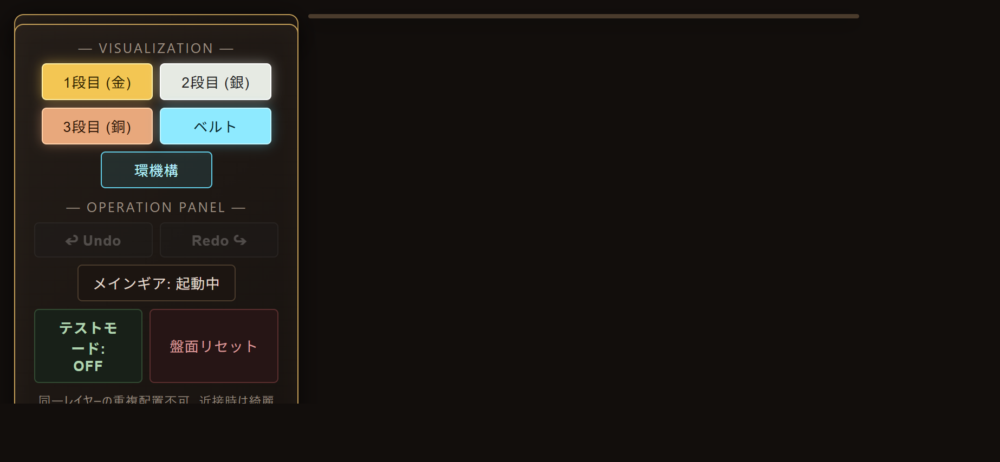

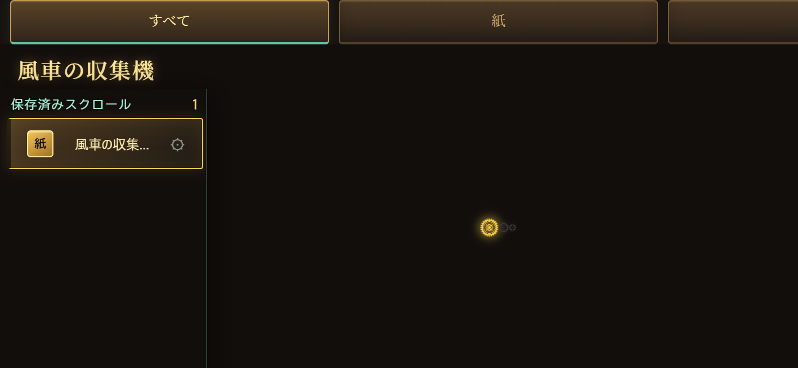

### 動力の確認

ダッシュボードではスチーム・水・霧・動力の保有量と、資源ごとの生成・回収・消費を確認できます。スクロールや設備が停止したときは、動力源と必要資源の両方を確認してください。

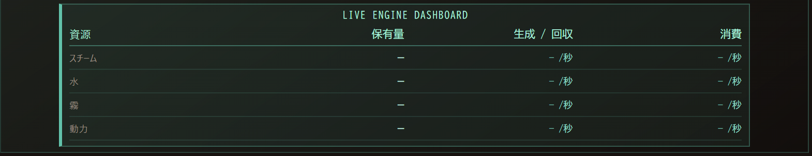

## ゲームの基本ループ

```text
島を探索する
    ↓
地形から素材を集める
    ↓
素材を加工して部品・スクロール・建築キットを作る
    ↓
ギアを設計してスクロールに保存する
    ↓
動力を供給し、スクロールや設備を稼働させる
    ↓
新しい資源・建築・加工へ進む
```

最初は移動して周囲を調べ、インベントリで素材とレシピを確認するのがおすすめです。ギア設計は、スクロール素材を選んで編集画面を開き、メインギアに接続する形で組み立てます。保存後はスクロール書庫からいつでもプレビューできます。

## 遊び方

### 1. 移動とマップ操作

- 方向ボタン、ジョイスティック、W/A/S/D、矢印キーでプレイヤーを移動します。
- ボタンやスティックを押し続けると連続して移動します。
- マップをドラッグすると視点を移動できます。ホイールまたはピンチでズームします。
- 上部のステータスから体力・スチーム・座標を確認できます。
- スマートフォンは横向き表示を含む各画面サイズに対応しています。縦向きでもプレイできます。
- 対応端末では移動時に振動します。ゲーム音は設定画面から調整できます。

### 2. 素材を集めて加工する

インベントリの「加工・合成」タブでレシピと必要素材を確認し、製作を開始します。材料が不足しているレシピは開始できません。手作業でつくれるもののほか、建物の製作設備にスクロールをセットして行う製作があります。

建物設備の製作は、対応するスクロールと動力在庫が必要です。動力が切れると進捗を保ったまま停止し、供給が戻ると再開します。オーバークロックを設定できる設備では、速度を上げると動力消費も増えます。

### 3. 建築する

1. インベントリの「建築」タブでキットを作ります。
2. 所持品タブから建築キットを選び、詳細を開きます。
3. 単一配置または連続配置を選びます。
4. マップ上の配置可能なセルを選んで確定します。

建物の種類によって大きさ・必要素材・機能が異なります。ストレージには素材を保管できます。建物メニューからスクロールをセットできる設備では、製作や資源処理を自動化できます。

### 4. 全体マップを見る

ナビゲーションからワールドマップを開くと、島や領域を俯瞰できます。ドラッグで表示を移動し、ホイールまたはピンチで拡大・縮小します。

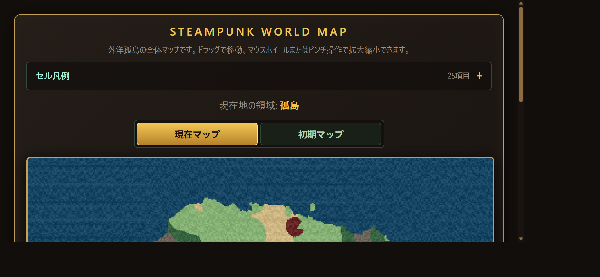

## 資源と動力

資源は所持品、地形、設備、ギアの処理で得られます。地形によって採取できる素材や必要な処理が異なります。

| 資源 | 主な用途 |
| --- | --- |
| 真鍮資材 | ギアの配置・設計、加工品や建築キットの材料 |
| 水 | 錬金系の処理入力 |
| 霧 | 霧の回収や霧を使う錬金処理 |
| スチーム | メインギアの動力源。ギアの駆動負荷や軸摩擦に応じて消費 |
| 動力 | 一部の設備製作・建築設備などで使う共有エネルギー |
| 地形素材 | 加工・合成、建築、スクロール素材の作成 |

水・霧・動力・スチームは通常の所持品枠とは別に管理される共有エネルギーです。所持品の枠上限を消費せず、ダッシュボードや対応する画面に保有量が表示されます。

ギアの回転にはスチームが必要です。ギアを増やすと駆動負荷が増え、固定されていない軸には摩擦負荷も発生します。回転が止まった場合は、スチーム残量、ギアの接続、処理に必要な入力資源、対象セルを確認してください。

## ギアと処理

ギア編集画面では、サイズ・レイヤー・ギア種・処理内容を設定します。中心のメインギアから処理ギアまで、途切れない動力経路をつくるのが基本です。

### 接続の基本

- **噛み合い**: 同一レイヤーで歯が接するギア同士が接続します。サイズ比に応じて回転速度が変化し、隣り合うギアは回転方向が反転します。
- **同軸**: 同じ座標の異なるレイヤーに配置したギアを同軸として扱います。「同軸同期」を有効にすると回転を同期できます。
- **ベルト**: 2つのギアをベルトで接続します。接続元・接続先のサイズに応じて速度が変わります。
- **3つのレイヤー**: 1段目は金、2段目は銀、3段目は銅です。表示切替は可視化のみで、ギアの動作や接続状態を変更しません。

ベルトの角速度は接続元・接続先のサイズ比で決まります。

```text
接続先の角速度 = 接続元の角速度 × 接続先サイズ ÷ 接続元サイズ
```

盤面の可視化ボタンではレイヤー、ベルト、環機構の表示を切り替えられます。同軸位置にギアが重なる場合は、ホイール（スマートフォンではギア切替操作）で選択対象を切り替えます。

### ギア種と処理内容

| ギア種 | 選べる処理 | 主な働き |
| --- | --- | --- |
| 工業・動力 | 動力を蓄積 | 回転を使って共有動力を生成します。 |
| 産業・生産 | 霧の回収、資材収集 | 霧を集める、または対象セルから素材を採取します。 |
| 錬金 | 水→スチーム、霧→水、地形変成、時代変質 | 資源を変換する、対象セルの地形を変える、または時代を変質させます。 |
| 精密・制御 | 対象セルの上下左右シフト、条件制御 | 処理対象を動かす、指定条件に応じてメインギアや同軸ギアを制御します。 |

「処理なし」も選べます。実際に選べる処理はギア種によって異なります。地形変成など対象セルを使う処理では、対象位置と入力素材を確認してください。

#### 条件制御

精密・制御ギアの条件制御では、メインギアの停止・起動や、同軸ギアの同期状態を操作できます。条件には、制御ギアの回転回数やアイテム所持数を設定できます。アイテム数条件はメインギア停止中も監視されます。

ギア編集の詳しい操作は[GearSystem/README.md](GearSystem/README.md)も参照してください。

## スクロールの作成と運用

スクロールは、ギアの配置・処理・対象設定を保存した設計図です。ギア盤面で作った構成を保存し、書庫から再利用できます。

### 作成・起動

1. 所持品から紙・強化紙・布・耐圧布・合金錬成布のスクロール素材を選びます。
2. 「ギア編集」を開き、メインギアにつながるようにギアと必要なベルトを配置します。
3. ギア種ごとに処理内容を設定します。対象セルや条件が必要な処理では、それらも設定します。
4. 設計名と効果を指定して保存します。対応するスクロール素材を1個消費します。
5. 保存ギアプレビューまたはスクロールブックで設計を選び、接続や対象を確認して起動します。

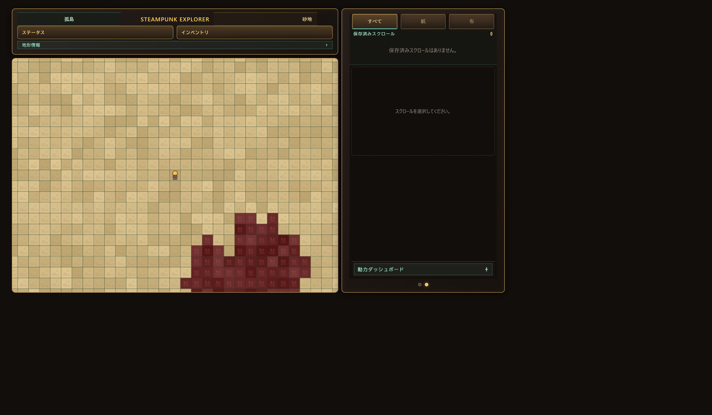

手元で起動したワールドに作用するスクロールは、プレイヤーが対象セルから移動すると停止します。地形・周囲に影響しない手元処理は、移動後も継続できます。建物などにセットして起動するスクロールは、その設備に固定された対象位置で稼働します。

### 耐久度・写本・共有

スクロールには素材ごとの耐久度があり、使用回転数が上限に達すると停止します。上限は素材によって異なります。耐久度を使い切った設計はレガシーとして確認できます。

スクロールブックでは、設置中でない保存設計を写本できます。写本には対応するスクロール素材と、設計に含まれるギアに応じた真鍮資材が必要です。不要な設計は確認画面を経て削除できます。削除した設計は元に戻せません。

「QRで共有」では設計データを含むQR画像を作成します。受け取る側はカメラまたは画像から読み込みます。QR共有はオンラインリンクではなく、画像を相手に渡す方式です。カメラを使うにはHTTPS接続とブラウザーのカメラ許可が必要です。

## 建築・生産設備

建築キットを作って配置すると、探索・保管・生産を拡張できます。設備にスクロールをセットできる場合は、設備のメニューから設計を選択して動力を供給します。

- **ストレージ**: 素材を種類ごとのスタックとして保管し、必要な量を取り出せます。
- **スクロール台**: スクロールを設置セルに固定して稼働させます。採取素材は条件に合う近隣ストレージへ優先して収納され、余剰は所持品に入ります。
- **機関車・貨車**: 線路上を走行し、個体ごとに動作スクロールをセットします。線路を連続させ、必要な場所には駅舎を設置します。
- **作業オートマタ**: 指定経路を巡回し、採取・地形処理・倉庫間の資材搬送などを行います。稼働には個体用の動作スクロールが必要です。
- **製作設備**: スクロールと動力を使って製作します。動力不足では進捗を保持して一時停止します。

建物ごとの材料、条件、詳しい処理内容はゲーム内の加工・建築ガイドを参照してください。

## 設定・セーブデータ

設定画面ではワールドシード、マップ初期ズーム、スキン、サウンドなどを調整できます。ワールドマップ、セル・素材一覧、加工・建築ガイドもゲーム内ナビゲーションから開けます。

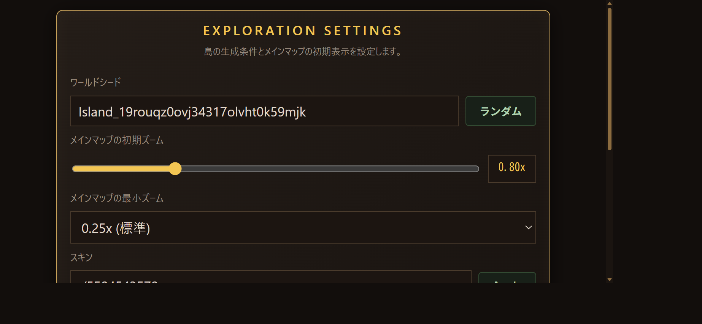

ゲームの進行状況はブラウザーのローカルストレージに保存され、端末・ブラウザー・オリジンごとに独立しています。通常のブラウザー版とインストール版のデータは別扱いになる場合があります。ブラウザーのデータ削除や別端末への移行に備え、設定画面にデータのバックアップ／復元機能が表示される場合は、定期的にバックアップしてください。

ゲームリセットには次の選択肢があります。

- **オールリセット**: 保存ギア設計を含む進行データを初期化します。
- **強くてニューゲーム**: 保存ギア設計を残し、それ以外の進行を初期化します。

いずれも実行前に確認してください。削除された進行データは復元できません。

## 起動とインストール

### ローカルで起動する

Python 3が利用できる環境で、リポジトリのルートディレクトリから実行します。

```powershell
python serve.py
```

既定では `http://localhost:8000/` で起動します。ポートを変更する場合:

```powershell
python serve.py --port 8080
```

ブラウザーで `http://localhost:8000/` を開くと、ゲーム画面へ移動します。ES Modules、Service Worker、カメラ共有などブラウザー機能の一部は、HTTPSまたはlocalhostでの実行が必要です。HTMLファイルを直接開く `file://` ではなく、HTTPサーバー経由で起動してください。

### PWAとしてインストール・オフライン利用する

1. HTTPSで公開されたアプリ、またはlocalhostのURLを開きます。
2. オンラインで一度起動し、読み込みとキャッシュ取得が完了するまで待ちます。
3. ブラウザーのメニューから「インストール」または「ホーム画面に追加」を選びます。
4. インストール後も一度アプリを開き、必要なデータの取得が完了してからオフラインで利用します。

Service Workerの初回キャッシュ取得にはネットワーク接続が必要です。効果音の実録音素材も初回キャッシュに含まれるため、初回はダウンロード完了までオンラインで待ってください。公開版が更新された場合は、オンラインで再読み込みするとキャッシュが更新されます。

## プロジェクト構成

| パス | 内容 |
| --- | --- |
| `index.html` | エントリーポイント。ゲーム画面へ転送します。 |
| `MainSystem/` | アプリ起動用ページとアプリアイコン。 |
| `MapSystem/` | 探索、インベントリ、建築、設定、ワールドマップ、ガイド、ゲーム音響。 |
| `GearSystem/` | ギア編集、ギアシミュレーション、スクロール書庫、QR共有。 |
| `design/` | 効果音の参照・検証用ツールや設計資料。 |
| `serve.py` | ローカル開発用HTTPサーバー。 |
| `sw.js`, `MapSystem/sw.js` | PWAのオフラインキャッシュと更新管理。 |

アプリはフロントエンド主体で、ゲーム進行は利用ブラウザーに保存されます。ローカル開発に必要なコマンドは上記のHTTPサーバー起動です。ビルド工程を使わず、HTML・CSS・JavaScriptをブラウザーで読み込みます。

## 関連ドキュメント

- [ギア編集の詳細ガイド](GearSystem/README.md)
- [開発ポリシー](DEVELOPMENT_POLICY.md)
- [ゲーム内ガイド・セル／素材一覧](MapSystem/cell-atlas.html)
- [設定画面](MapSystem/settings.html)
